<p align="center">
  
</p>

<p align="center">
  <a href="https://github.com/netspeedy/s3ctl/actions/workflows/build-and-validate.yml"></a>
  <a href="https://github.com/netspeedy/s3ctl/actions/workflows/container-image.yml"></a>
  <a href="https://github.com/netspeedy/s3ctl/releases"></a>
  <a href="https://github.com/netspeedy/homebrew-s3ctl"></a>
  <a href="https://netspeedy.github.io/s3ctl/"></a>
  <a href="https://github.com/netspeedy/s3ctl/pkgs/container/s3ctl"></a>
  <a href="go.mod"></a>
</p>

---

s3ctl creates S3-compatible buckets and gives each one its own access key. For
every bucket it can create the bucket, turn on versioning and apply a bucket
policy, then create an IAM user with an access key and a policy that only allows
access to that one bucket. It works with any S3/IAM-compatible endpoint, and with
OVHcloud Public Cloud Object Storage through the OVHcloud API.

It's a single command with no subcommands. You describe the buckets with flags, a
JSON config or a CSV batch file, and `--dry-run` prints the plan before anything
changes. The same command rotates and re-scopes OVHcloud credentials and deletes
buckets, and it won't empty a bucket unless you pass `--force`. Text output is for
people; `--output json` gives scripts a payload for successes and errors alike.

**Quick links:** [Install](#install) · [Try it](#try-it) · [Usage guide](docs/usage.md) · [OVHcloud](docs/ovhcloud.md) · [Examples](examples) · [Releases](https://github.com/netspeedy/s3ctl/releases) · [Website](https://netspeedy.github.io/s3ctl/)

---

## Install

On macOS or Linux, Homebrew is the easiest route:

```bash
brew tap netspeedy/s3ctl
brew install s3ctl
```

Or use the installer script. It installs into a bin directory you own and clears
the macOS quarantine flag, which a manually downloaded binary would otherwise trip
over because the releases aren't notarised yet:

```bash
curl -fsSL https://netspeedy.github.io/s3ctl/install.sh | bash
```

[docs/installation.md](docs/installation.md) covers the signed APT repository for
Debian and Ubuntu, pinned versions, release candidates and the GHCR image.

## Try it

Plan a bucket and its scoped credentials without changing anything:

```bash
s3ctl --bucket app-data --create-scoped-credentials \
  --endpoint https://objects.example.com --dry-run
```

It prints the plan:

```text
S3 Provisioning Result
======================
Resources: 1
Mode: dry-run

Bucket: app-data
Endpoint: https://objects.example.com
Region: us-east-1
Bucket create planned: yes
Versioning requested: no
Encryption requested: no
Bucket policy planned: no
Scoped credentials planned: yes
IAM user: app-data
Credential policy template: bucket-readwrite
Access key ID: (generated on apply)
Secret access key: (generated on apply)
```

Drop `--dry-run` to create the bucket, the IAM user and the key. The secret access
key is printed this once and never again, so store it straight away. s3ctl finds
S3 credentials the same way the AWS CLI does, or you can pass `--profile`. Add
`--output json` when a script is reading the result.

On OVHcloud the same request goes through the Public Cloud API:

```bash
s3ctl --provider ovh --bucket app-data --region UK \
  --ovh-service-name PUBLIC_CLOUD_PROJECT_ID --output json
```

Here `--region` is an OVHcloud Public Cloud region such as `UK`, `GRA`, `BHS`,
`SBG` or `EU-WEST-PAR`, not an AWS-style region like `us-east-1`.

For a first real bucket:

1. Put shared provider settings in `~/.config/s3ctl/config.json`.
2. Run `s3ctl --bucket app-data --dry-run --output json`.
3. Check the endpoint, region and credential scope in the plan.
4. Run `s3ctl --bucket app-data --output json`.
5. Store the returned access key and secret somewhere safe.

## The rest of the lifecycle

Rotation, policy repair and deletion run from the same command:

```bash
# Rotate an existing OVHcloud bucket keypair
s3ctl --provider ovh --bucket app-data --ovh-rotate-credentials --output json

# Re-scope an existing OVHcloud bucket user policy
s3ctl --provider ovh --bucket app-data --ovh-repair-policies --output json

# Delete an empty bucket (preview first with --dry-run)
s3ctl --bucket app-data --delete --dry-run
s3ctl --bucket app-data --delete                 # empty bucket, no --force needed
s3ctl --bucket app-data --delete --force         # non-empty bucket requires --force

# Show the installed version (add --output json for a machine-readable payload)
s3ctl --version
```

Repeat `--bucket` to work on several buckets at once, or pass a CSV file with
`--batch-file`. Settings resolve in this order: flags, then the JSON config, then
the built-in defaults, so shared provider settings can live in the config while
anything specific to one run stays on the command line.
[docs/usage.md](docs/usage.md) covers batch files, JSON config, the IAM permissions
s3ctl needs and the JSON error payloads.

## Policy templates

There are two sets of templates. Bucket policy templates are attached to the bucket
itself and only apply to the S3 provider. Scoped-credential templates are attached
to the IAM or OVHcloud user that `--create-scoped-credentials` creates.

Bucket policy templates (`--bucket-policy-template`):

| Template | Coverage |
| --- | --- |
| `deny-insecure-transport` | Denies all S3 actions against the bucket and objects when requests do not use secure transport. |
| `public-read` | Allows public `s3:GetObject` access to objects in the bucket. |

Scoped-credential templates (`--credential-policy-template`, default `bucket-readwrite`):

| Template | Coverage |
| --- | --- |
| `bucket-readonly` | Bucket location lookup, bucket listing, and object reads for one bucket. |
| `bucket-readwrite` | Bucket location lookup, listing, object reads, writes, deletes, and multipart uploads for one bucket. |
| `bucket-admin` | All S3 actions against one bucket and its objects. |

<details>
<summary><strong>Common flags</strong></summary>

s3ctl has over 40 flags. These are the ones you'll use most; `s3ctl --help-full`
lists every flag, template and CSV field.

| Flag | Purpose |
| --- | --- |
| `--provider s3\|ovh` | Provider to target; defaults to `s3` |
| `--bucket` | Bucket name; repeat for many, or use `--batch-file` for CSV |
| `--config` / `-c` | Path to a JSON config file |
| `--endpoint` / `--region` | S3 endpoint and region |
| `--create-scoped-credentials` | Create an IAM/OVH user and access key scoped to each bucket |
| `--credential-policy-template` | Scoped-credential template (default `bucket-readwrite`) |
| `--bucket-policy-template` / `--bucket-policy-file` | Built-in or custom bucket policy |
| `--enable-versioning` | Enable bucket versioning after creation |
| `--delete` | Delete buckets instead of creating them (`--force` for non-empty) |
| `--ovh-rotate-credentials` | Rotate OVHcloud S3 keypairs (OVHcloud only) |
| `--ovh-repair-policies` | Re-apply scoped OVHcloud user policies (OVHcloud only) |
| `--dry-run` | Show the planned actions without making changes |
| `--output text\|json` | Output format; defaults to `text` |
| `--timeout` | Overall operation timeout; defaults to `10m` |
| `--version` | Print version information |
| `--help` / `--help-full` | Short reference / complete flag, template, and CSV reference |

</details>

## OVHcloud

`--provider ovh` creates OVHcloud Object Storage through the Public Cloud API.
OVHcloud calls buckets "containers", but s3ctl keeps calling them buckets because
the credentials it hands back are S3-compatible.

For each bucket the OVHcloud provider creates one Public Cloud user and one S3
credential pair, creates the container in `--region`, and attaches the user to it
with the matching container profile (`readWrite` by default). It then imports an
OVHcloud S3 user policy scoped to that bucket, which also stops the user listing
every bucket in the project. JSON output reports that policy as
`scoped_access_policy_applied`. Bucket policy documents aren't used on OVHcloud,
where access is controlled by container profiles and S3 user policies instead.

It needs these settings:

- `provider`: `ovh`
- `ovh_service_name`: the Public Cloud project ID/service name
- one OVHcloud auth mode: OAuth2 service account credentials, an access token,
  classic OVH API application credentials, or standard go-ovh client discovery
  such as `ovh.conf`
- `region`: an OVHcloud Public Cloud/Object Storage region such as `UK`, `GRA`,
  `BHS`, `SBG`, or `EU-WEST-PAR`

[docs/ovhcloud.md](docs/ovhcloud.md) covers OAuth2 service account setup, the
least-privilege IAM actions, storage policy roles, credential rotation, policy
repair and bucket deletion on OVHcloud.

## Container

Build locally:

```bash
make docker-build
docker run --rm s3ctl:dev
```

Use the published image:

```bash
docker run --rm ghcr.io/netspeedy/s3ctl:latest
```

Run against the bundled examples from the host:

```bash
docker run --rm \
  -v "$PWD/examples:/examples:ro" \
  ghcr.io/netspeedy/s3ctl:latest \
  --config /examples/aws/s3ctl.json \
  --dry-run \
  --output json
```

## Releases

Stable releases publish Linux and macOS archives, Debian packages, signed
checksums, GHCR images, release-hub metadata and signed APT repository metadata.
Release candidates use tags such as `v1.2.3-rc.1` while a version is being
validated. [docs/release.md](docs/release.md) has the release, website preview and
dependency update notes.

## Development

Build and run it locally:

```bash
make build
./dist/s3ctl --help
```

These checks are the minimum before a change lands:

```bash
make lint-install
make fmt-check
make lint
make vet
make test
make build
```

`gofmt` is the baseline formatter, and the pinned `golangci-lint` configuration
adds `gofumpt`, `goimports`, `staticcheck`, `errcheck` and `revive`. To format,
build the release artifacts and preview the website:

```bash
make fmt
make build-release
make website-install
make website-build
make website-capture
```

The banner at the top of this page is generated. Edit the copy, layout or timing
in `scripts/readme/build_readme_hero.py` and run `make readme-hero` to rebuild
`assets/s3ctl-readme-hero.svg`. It downloads the font subsets from Google Fonts, so
it needs network access. If you change the headline's words, measure them again
with `scripts/readme/measure_headline.py`, which explains its own dependencies.

Issues and pull requests are welcome. [AGENTS.md](AGENTS.md) has the full
repository conventions.

## License

Copyright © 2026 [Simon Oakes](https://github.com/soakes). Released under the
[MIT License](LICENSE).

`s3ctl` is an unofficial community tool and is not affiliated with, endorsed by,
or sponsored by AWS, Amazon S3, or OVHcloud.
